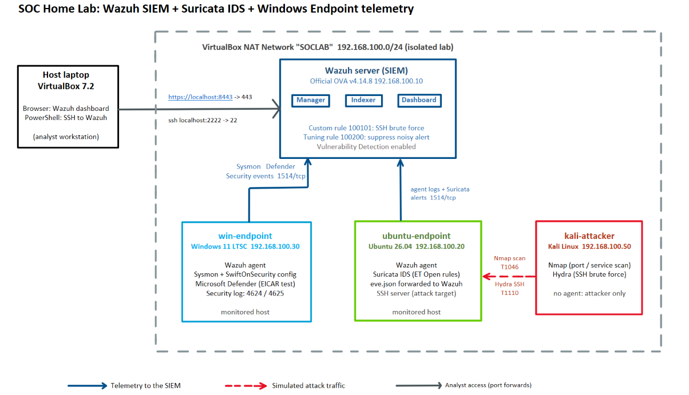
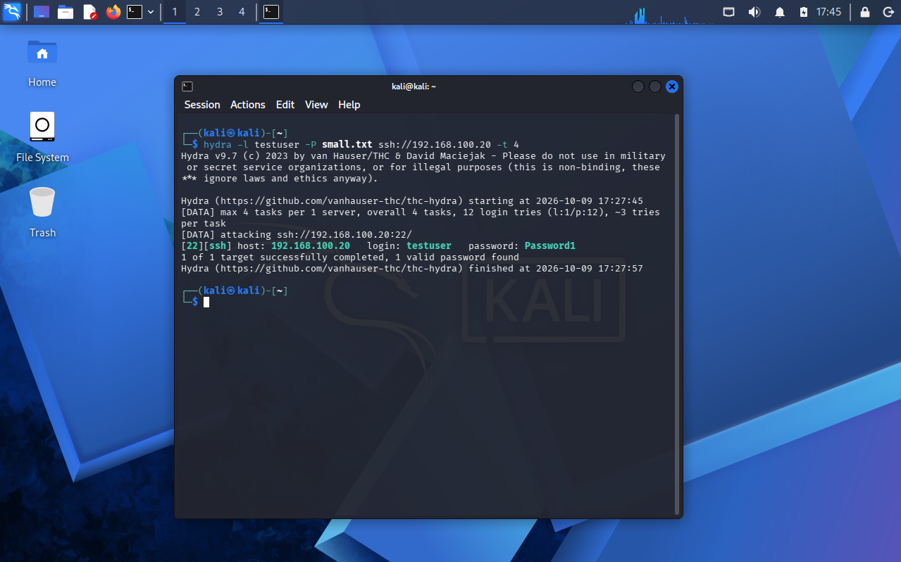
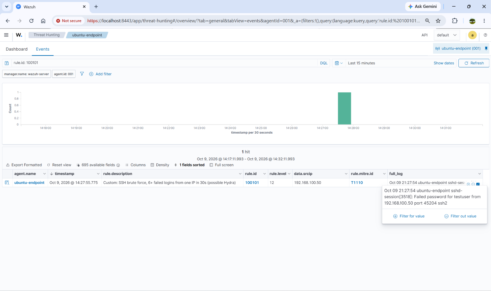
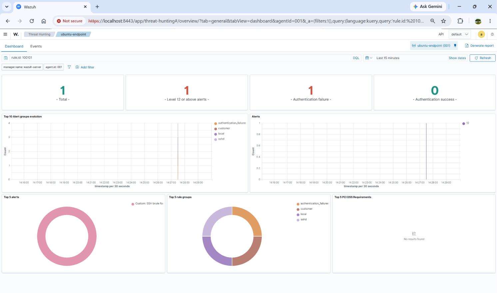

# SOC Home Lab: Wazuh SIEM, Suricata IDS and Windows Endpoint Monitoring

An isolated virtual lab I built to practice Level 1 SOC work: collecting network and endpoint telemetry, detecting simulated attacks, triaging alerts, tuning noisy detections, and checking hosts for known vulnerabilities.

**Tools:** Wazuh 4.14 (SIEM, EDR agent, vulnerability detection), Suricata 8 (IDS), Sysmon, Microsoft Defender, Nmap, Hydra, MITRE ATT&CK, VirtualBox.

## Architecture

| VM | Role | IP |
|---|---|---|
| Wazuh server (official OVA, v4.14.8) | SIEM: manager, indexer, dashboard | 192.168.100.10 |
| ubuntu-endpoint (Ubuntu 26.04) | Monitored host: Wazuh agent + Suricata IDS | 192.168.100.20 |
| win-endpoint (Windows 11 IoT Enterprise LTSC 2024, evaluation) | Monitored host: Wazuh agent + Sysmon + Defender | 192.168.100.30 |
| kali-attacker (Kali Linux) | Attacker: Nmap, Hydra | 192.168.100.50 |

All VMs sit on an isolated VirtualBox NAT network (`192.168.100.0/24`). I reach the dashboard from my laptop through a port forward (8443 to 443) and SSH to the Wazuh server through another (2222 to 22).

The laptop has about 13.7 GB of usable RAM, so I ran the lab in two phases: Wazuh + Ubuntu + Kali for the network attacks, then Wazuh + Windows for the endpoint work.

## What I did

1. Built the network and VMs and confirmed connectivity between them.
2. Deployed the Wazuh server and enrolled the Ubuntu and Windows agents (both Active on v4.14.8).
3. Installed Suricata (Emerging Threats Open rules) and forwarded its `eve.json` alerts to Wazuh.
4. Installed Sysmon (SwiftOnSecurity config) on Windows and forwarded the Sysmon and Defender channels to Wazuh.
5. Ran simulated attacks, investigated the alerts in the dashboard, and mapped them to MITRE ATT&CK.
6. Wrote a custom detection rule and a tuning rule, and measured the effect of the tuning.
7. Reviewed the vulnerability findings for the Ubuntu endpoint.

## Results

| Test | How | Detection | Result | Evidence |
|---|---|---|---|---|
| Service scan (T1046) | `nmap -sS -sV -p 1-1000 --script http-title` from Kali | Suricata `ET SCAN Possible Nmap User-Agent Observed` (Wazuh rule 86601, level 3) | Detected, via the NSE user-agent | `03-attacks/07a-*` |
| SSH brute force (T1110) | `hydra`, 12 passwords | Wazuh rules 5763 (level 10) and 40112 (level 12), plus my custom rule 100101 (level 12) | Detected | `03-attacks/07b-*` |
| Failed Windows logons | 6 wrong passwords at the lock screen | Event 4625, rule 60122 (level 5), tagged T1531 by Wazuh | Detected. These were local logons, not a remote attack, and the multiple-failures correlation rule did not trigger at 6 attempts. | `07-windows/07c-*` |
| Successful Windows logon | Correct password after the failures | Event 4624, rule 60118 (level 3) | Detected | `07-windows/07c-*` |
| Antivirus test | EICAR test file downloaded on Windows | Defender event 1116, Wazuh rule 62123 (level 12). Defender quarantined the file. | Detected | `07-windows/07d-*` |
| Endpoint telemetry | Normal activity plus PowerShell commands | Sysmon events (process creation, file creation) in Wazuh, for example rules 92205, 92213 and 92217 | Collected | `07-windows/04-*` |

MITRE view: `04-detections/08-mitre-dashboard.png`

## Case study 1: SSH brute force

- **Source:** 192.168.100.50, **target:** ubuntu-endpoint, **account:** `testuser`
- Hydra made 11 failed logins in about 12 seconds, then logged in successfully with the same account.
- Wazuh's correlation rule 40112 ("Multiple authentication failures followed by a success", level 12, T1110 and T1078) fired on that successful login. That is what turns noisy failures into a probable compromise (`04-detections/08-mitre-events.png`).
- That one attempt produced about 25 alerts across four rule families (sshd, PAM, unix_chkpwd, syslog), which shows why alerts need correlating and tuning.
- **Verdict:** true positive, probable credential compromise.
- **Escalation to L2:** source IP, account name, timestamps of the failures and the success; recommend a password reset, checking the account's activity after login, and isolating the source host.

## Case study 2: Sysmon alerts that were false positives

Two Sysmon alerts looked serious at first:

| Rule | Level | What it said |
|---|---|---|
| 92213 | 15 | Executable file dropped in a folder commonly used by malware |
| 92205 | 9 | PowerShell process created an executable file in the Windows root folder |

I opened both and checked the process, the user, and the file name. In both cases `powershell.exe` created a `__PSScriptPolicyTest_*.ps1` file, which PowerShell writes itself when it starts and checks its execution policy. Rule 92213 came from my own `labadmin` session (in its `%TEMP%` folder). Rule 92205 came from a SYSTEM-level PowerShell (in `C:\Windows\SystemTemp`) and kept repeating: 63 alerts from the two rules in 7 days, the kind of noise that buries real alerts. Evidence: `07-windows/04a-*`, `04b-*`, `04c-*`.

- **Verdict:** false positive. I verified the user, path, and file name; I did not trace which service launched the SYSTEM-level PowerShell.
- **Recommendation for L2:** exclude the `__PSScriptPolicyTest_*` file name pattern from rules 92213 and 92205, so real droppers stay visible.

## Custom detection rule

`04-detections/local_rules.xml`, rule `100101`: fires when one source IP causes 6 or more failed SSH logins within 30 seconds (level 12, T1110). Wazuh's built-in brute-force rule waits for 8 failures in 120 seconds, so the custom rule alerts sooner and at a higher severity. In `wazuh-logtest` a single failed-login line only reaches the parent rule 5760 (level 5), because 100101 is a frequency rule; it fires on live Hydra traffic, as below.

**1. The test:** the same Hydra attack, run again after adding the rule.

**2. The alert:** rule 100101 fired at level 12 for source 192.168.100.50, tagged T1110.

**3. The dashboard view:** one level-12 alert from the custom rule.

## Tuning a noisy alert

`ET INFO Python SimpleHTTP ServerBanner` fires on benign traffic from the lab's own test web server, next to the real Nmap alerts.

I added a narrow level-0 child rule (100200) that matches only that signature on the Suricata parent rule 86601, then ran the same scan again:

| Alert | Before the rule | After the rule |
|---|---|---|
| `ET INFO Python SimpleHTTP ServerBanner` (benign) | 9 | 0 |
| `ET SCAN Possible Nmap User-Agent Observed` (real detection) | 5 | 5 |

The noisy signature disappeared and the Nmap detection stayed the same. I validated the rule file with `wazuh-analysisd -t` before restarting the manager, and `wazuh-logtest` confirmed the suppression: the sample Suricata alert resolves to rule 100200 at level 0 (`05-tuning/10c-logtest-suppression.png`). **Recommendation for L2:** in production, scope this suppression to the known web server's IP and review it periodically. Evidence: `05-tuning/`

## Vulnerability detection

Wazuh's Vulnerability Detection scanned `ubuntu-endpoint` and reported 152 Critical, 862 High, 95 Medium and 7 Low findings, with 1,394 more still pending evaluation. Almost all of them (2,509 of 2,510) come from one package, the Linux kernel image, so the practical remediation is one kernel update rather than many separate fixes. I treat raw CVE counts with caution: severity, exposure and exploitability decide priority. Evidence: `06-vulnerabilities/`

## Problems I ran into

- **Wazuh installer kept failing:** the all-in-one installer failed on Ubuntu 22.04 and 24.04 VMs. The logs showed CPU stalls and timeouts, and Task Manager showed the host at 93% memory. I switched to Wazuh's pre-built OVA and limited how many VMs run at once.
- **Agent would not start:** I had placed the Suricata `<localfile>` block outside the `<ossec_config>` tags. Fixed by adding it inside a valid section.
- **Log decoder errors:** Suricata's periodic `stats` events had too many fields for Wazuh's JSON decoder and flooded `ossec.log`. Turning off Suricata's global stats setting broke Suricata, so I reverted that and disabled only the `stats` entry in the `eve-log` output.
- **A bad rule edit took down the manager:** a typo in `local_rules.xml` (`fieldname` instead of `field name`) made the Wazuh manager fail to start. The dashboard still loaded, but agents could not connect, so I had a working-looking dashboard and no new data. I restored a known-good file and now run `wazuh-analysisd -t` before restarting the manager.
- **First EICAR detection never reached Wazuh:** Defender detected and quarantined the file, but the event was lost while the manager was restarting (the manager log showed `Unable to connect to socket 'queue/db/wdb'`). Once the manager was stable, a second test arrived as rule 62123.
- **Windows commands failed silently:** installing Sysmon and restarting the agent need an elevated PowerShell. I had opened a normal one.
- **Weak scan detection:** the Nmap SYN scan alone was not flagged by the default rules, and the alert I got was low severity (level 3). A scanner like this would need correlation before escalating.

## Notes

- Everything runs in a closed lab. The weak test account (`testuser`) exists only for the Hydra test, and the Windows VM uses an evaluation licence.
- The Windows failed-logon test was local only. I did not attack the Windows VM from Kali.
- Screenshots are in the numbered folders; file names match the table above.
